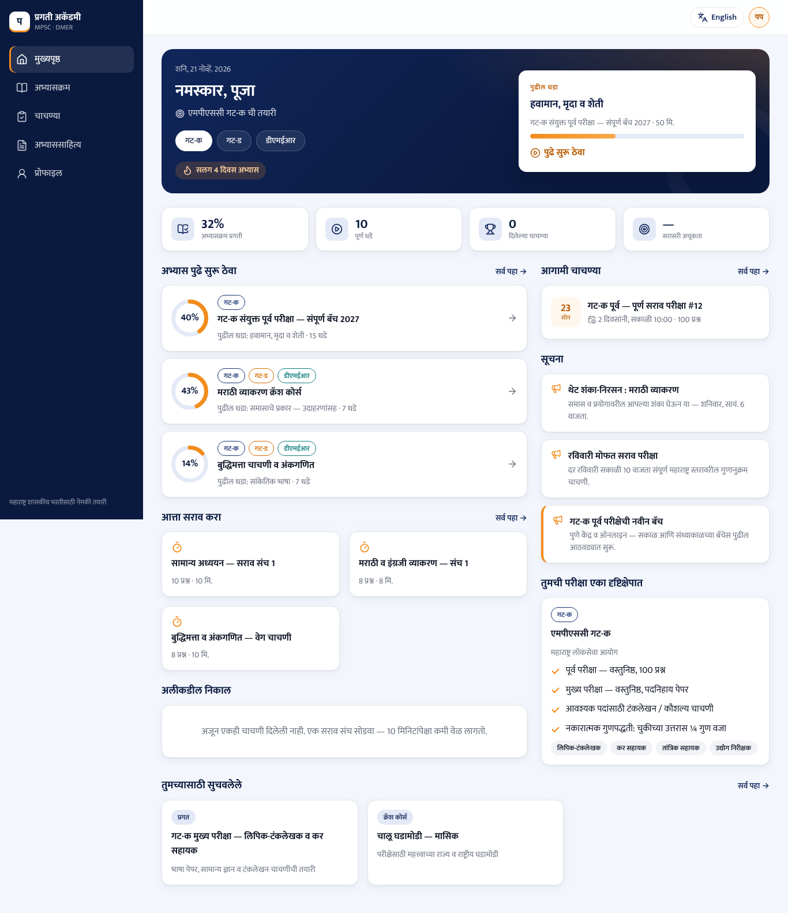
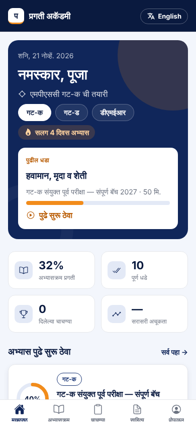

# Sam Xplains studio + लक्ष्य Academy platform

This repository holds two independent projects:

| Project | Folder | What it is |
| --- | --- | --- |
| **Sam Xplains video studio** | [`apps/video`](apps/video) | The existing Remotion production system (MPSC History and all other compositions, presenter workflow, audio, fonts, `render:final`). Unchanged; see [`apps/video/README.md`](apps/video/README.md) and [`apps/video/docs/VIDEO-WORKFLOW.md`](apps/video/docs/VIDEO-WORKFLOW.md). |
| **Educational platform** | `apps/web`, `apps/mobile`, `packages/*` | The new website and Android app (below). |

## Video studio (apps/video)

The video project has its **own, separate install** (its own `package-lock.json`, React 19.3.1), so the platform can never change its dependencies. Run every video command from `apps/video`, exactly as before the move:

```bash
cd apps/video
npm ci                                              # once
npm run dev                                         # Remotion Studio
npm run render:final -- MpscHistory mpsc-history    # final MP4 → apps/video/out/final-video/
scripts/workflow/make-cutout.sh public/videos/raw-video/<file> public/videos/cutouts/<name>.cutout.webm
HF_HUB_DISABLE_XET=1 python3 scripts/workflow/transcribe.py out/analysis/raw_<name>/voice16k.wav out/analysis/raw_<name>/transcript.json
```

Shortcuts from the repo root: `npm run video:install`, `npm run video:dev`, `npm run video:lint`, `npm run video:render -- <CompositionId> <name>`.

---

# लक्ष्य Academy (Lakshya Academy) — Student Platform

Web + Android learning platform for an independent coaching institute in Maharashtra, preparing students for **MPSC Group C**, **Group D** and **DMER** recruitment exams. Fully bilingual: **मराठी** and **English**.

> **ध्येय तुमचे, मार्गदर्शन आमचे!** — navy blue and gold.
>
> - Name and tagline: `packages/core/src/data/brand.ts`. Colours and the target-and-arrow mark: `packages/design/src/index.ts`, `packages/design/src/brand.ts`.
> - App icon, adaptive icon, splash and favicons are generated from the mark: `node --no-warnings packages/design/scripts/generate-brand-assets.mjs` (needs Playwright/Chromium).
> - Android package ID (permanent): **`com.lakshyaacademy.app`**, set in `apps/mobile/app.json`. It can never change after a Play Store release.

| Web (desktop, Marathi) | Android app |
| --- | --- |
|  |  |

## What works today (milestone 1)

- **Student dashboard** — greeting, target-exam switcher, study streak, "up next" lesson, stats, enrolled-course progress, practice tests, upcoming scheduled tests, announcements, exam pattern, recommendations.
- **Courses** — 7 realistic courses (filter by exam), course detail with syllabus; students mark lessons done and progress updates everywhere.
- **Tests** — 4 practice sets (32 real, bilingual questions) with a working timer, question palette, auto-submit, negative marking, scored results and answer review with explanations. Scheduled full mocks are listed but locked.
- **Study material** — notes, previous papers, current affairs, formula sheets with key points.
- **Profile** — change target exam and language, see progress, reset.
- **Login / registration previews** — branded screens with mobile-number validation; design only, nothing is saved or sent until accounts launch.
- **Marathi ⇄ English** everywhere, remembered between visits.
- Progress is saved **on the device** (browser storage / Android AsyncStorage).

**Not in this milestone (by design):** payments, database, login/accounts, video playback, PDF downloads. Buttons for these say "coming soon".

## Repository layout

```
apps/
  video/      Sam Xplains Remotion studio (separate install — not an npm workspace)
  web/        Next.js 16 website (App Router, TypeScript)
  mobile/     Expo SDK 58 Android app (expo-router, TypeScript)
packages/
  core/       Shared types, sample data, Marathi/English text, business logic, React state + test engine
  design/     Shared design tokens: navy / white / saffron palette, type scale, spacing
docs/         Architecture notes and screenshots
```

See [`docs/ARCHITECTURE.md`](docs/ARCHITECTURE.md) for the design decisions.

## Working from an Android phone

You don't need a computer:

1. **Make changes** in a Claude Code cloud session (claude.ai/code) on this repo, or edit files in the GitHub app.
2. **Check it works**: every push runs the **CI** workflow (GitHub app → *Actions*) with two independent jobs:
   - **video** — installs `apps/video` on its own, checks React 19.3.1, lints/typechecks, confirms all 15 compositions exist, warns if a branch changes any file under `apps/video`, renders a still of each and a short MpscHistory clip with audio.
   - **check** — lints, typechecks, runs unit tests, builds the website, bundles the Android app and clicks through both apps in a headless browser.
   Screenshots/stills are attached to each run as artifacts.
3. **Build the Android app** *(one-time setup)*: create an account at expo.dev → *Access tokens* → create a token → add it to this repo as the Actions secret `EXPO_TOKEN` (*Settings → Secrets and variables → Actions*). Then *Actions → Android build → Run workflow* and choose:
   - `preview-apk` (default): installable test APK.
   - `production-apk`: signed production APK to install on test phones.
   - `production-aab`: signed Android App Bundle for Google Play.
   - `production-apk-and-aab`: both production files.

   Builds run on Expo's servers (EAS). The workflow waits for them and attaches the `.apk`/`.aab` to the run: open the finished run and scroll to **Artifacts** (GitHub delivers it as a `.zip`; unzip to get the file). Builds are also listed on expo.dev → *Projects → lakshya-academy → Builds*. Production builds run only from `main`. Version codes are managed by EAS and increase with every production build.

   **Signing:** the first production build creates the app's signing key on EAS. Download a backup straight away (expo.dev → project → *Credentials → Android → Download keystore*) and keep it somewhere safe and private — never in this repository.

## Commands (for a cloud session or computer)

Requires Node 22.12+ for the platform (the video studio keeps its own requirement in `apps/video/package.json`).

```bash
npm install            # installs the platform workspaces (not apps/video)

npm run dev:web        # website on http://localhost:3000
npm run dev:mobile     # Expo dev server (scan the QR code with Expo Go)

npm run lint           # ESLint (Next.js, Expo and shared-package rules)
npm run typecheck      # all workspaces
npm test               # unit tests for shared logic and content
npm run build:web      # production web build
npm run export:android # compile the Android JS bundle (proves the app builds)
npm run check          # all of the above
```

End-to-end smoke tests (need the preinstalled Playwright/Chromium):

```bash
# web
npm run build:web && (cd apps/web && npx next start -p 3100 &)
BASE_URL=http://localhost:3100 node apps/web/e2e/smoke.mjs

# mobile (runs the Expo app through react-native-web at phone size)
cd apps/mobile && npm run export:web && (node e2e/serve.mjs dist/web 8090 &)
BASE_URL=http://localhost:8090 node e2e/smoke.mjs
```

## Secrets

None are needed to build or run the apps. Never commit `.env` files, keystores or tokens; they are git-ignored. The only secret is `EXPO_TOKEN`, stored in GitHub Actions secrets, for Android builds. The Android signing key lives on EAS (managed credentials), not in the repository.
